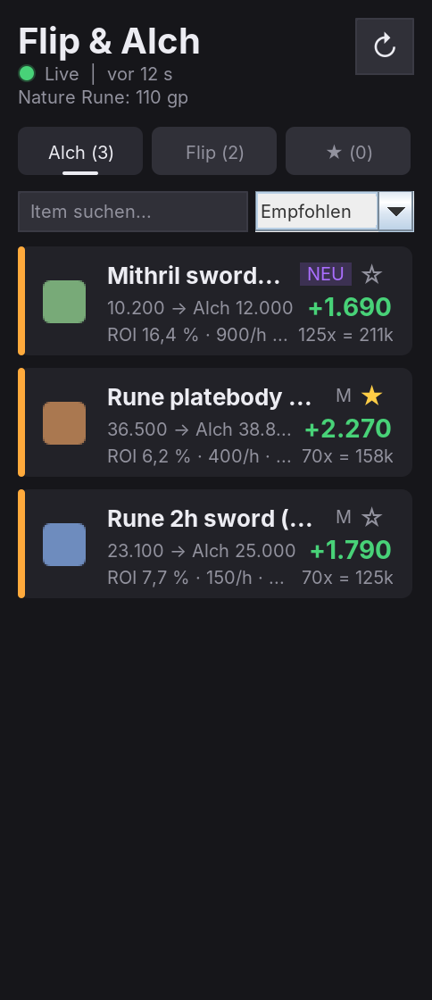
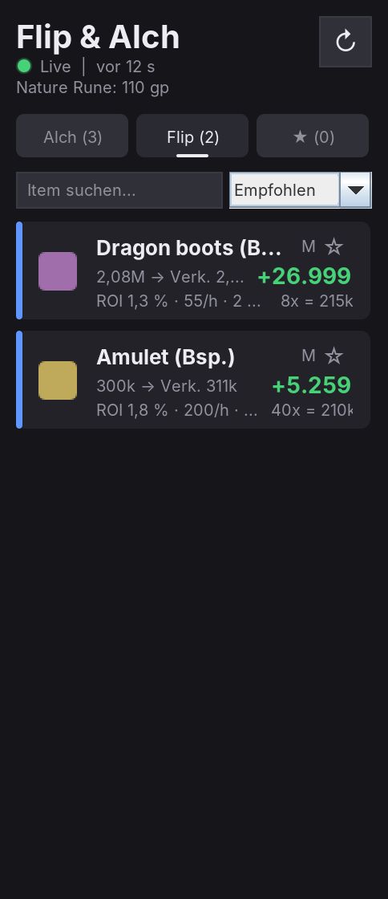

# Flip & Alch Assistant (RuneLite-Plugin)

Findet mit **Live-Preisen der OSRS-Wiki** profitable **High Alchs** (Standard ab **1.500 gp Gewinn**) und **Flips** und meldet neue Gelegenheiten sofort.
Ein reines **Analyse-Werkzeug**: Es klickt nichts im Spiel. Es braucht keine Microbot-Klassen und läuft deshalb in Microbot **und** im normalen RuneLite.

| Alch-Tab | Flip-Tab |
|---|---|
|  |  |

*Vorschau aus dem echten Panel-Code mit **Beispieldaten**. Item-Icons und RuneScape-Schrift sind Platzhalter, im Client siehst du die echten.*

## Rechnung

**Alch:** `Gewinn = High-Alch-Wert − Sofort-Kaufpreis − Nature Rune`

**Flip:** `Marge = (Sofort-Kauf − 1) − (Sofort-Verkauf + 1) − GE-Steuer`
GE-Steuer: 2 % vom Verkaufspreis, abgerundet, max. 5 Mio., unter 50 gp steuerfrei.

Berücksichtigt werden nur Items mit:
- **frischen Preisen** (Standard: max. 15 min alt)
- **genug Handelsvolumen** in der letzten Stunde, damit du das Item auch wirklich bekommst bzw. loswirst
- optional einem **maximalen Kaufpreis** (Budget) und einem **Members-Filter**

**Sortierung „Empfohlen“:** realistisch erzielbarer Gewinn pro Stunde, also Gewinn × min(Kauflimit, Volumen, ~1.200 Alchs/h).

## Funktionen

- **Dashboard** mit Live-Status (grüner Punkt, „vor 12 s“), Nature-Rune-Preis und Aktualisieren-Button
- **Tabs:** Alch, Flip und ★ Merkliste. Die Merkliste zeigt deine Items immer, auch wenn sie gerade unter der Schwelle liegen.
- **Suche** und **Sortierung** (Empfohlen, Gewinn/Stk, Gewinn/Limit, ROI, Volumen)
- **Karten:** Item-Icon, Kauf → Alch/Verkauf, Gewinn, ROI, Volumen/h, Preisalter, Gewinn bei vollem Kauflimit, „NEU“-Badge
- **Klick** auf eine Karte kopiert den Namen (direkt in die GE-Suche einfügen). **Rechtsklick** öffnet die Wiki-Seite oder den Preisverlauf.
- **Meldungen** per Desktop-Benachrichtigung und/oder Chat, ohne Spam:
  - beim Start nur eine Zusammenfassung
  - danach nur neue Items oder Items, deren Gewinn um 25 % gestiegen ist
  - Abklingzeit pro Item (Standard 30 min) und höchstens 3 Meldungen pro Update

## Effizienz

| Was | Wie |
|---|---|
| Preisabruf | eigener Hintergrund-Thread, Stammdaten alle 6 h, Volumen alle 5 min, Preise jede Minute |
| Analyse | ~1,5 ms für 5.000 Items (gemessen), auf eigenem Thread |
| Panel | baut die Liste nur bei neuen Daten neu, maximal 40 Karten; nur die Uhrzeit tickt jede Sekunde |
| Fehler | alte Daten bleiben sichtbar, Wartezeit verdoppelt sich bis max. 10 min |
| Einstellungen ändern | sofort neu rechnen ohne neuen Abruf |

## Tests

`src/test/.../AnalyzerTest.java` (JUnit) prüft Steuer, Alch-Schwelle inkl. Nature Rune, veraltete Preise, Volumen, Flip-Marge, Members-Filter, das JSON-Format der Wiki (auch `null`-Werte) und die Zahlenformatierung. Dieselben Fälle sind in der Entwicklungsumgebung gelaufen und **alle bestanden**.

## Einbauen

1. `src/main/java/net/runelite/client/plugins/flipassist` nach `runelite-client/src/main/java/net/runelite/client/plugins/flipassist/` kopieren (optional auch den Test nach `src/test/...`).
2. `./gradlew :client:compileJava`
3. Im Client **„Flip & Alch Assistant“** aktivieren und rechts auf das **$**-Icon klicken.

> **Status:** Rechenlogik, Parser und Formatierung sind getestet, das Panel-Layout ist per Vorschau geprüft.
> Das komplette Plugin ist **noch nicht im RuneLite-Client kompiliert** und der Live-Abruf von `prices.runescape.wiki` konnte in der Entwicklungsumgebung nicht getestet werden (Domain gesperrt).
